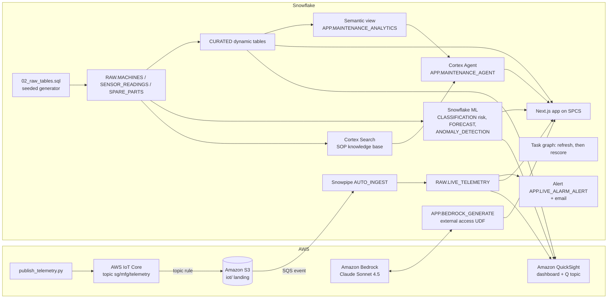

# Singapore Predictive Maintenance - Discrete Manufacturing

End-to-end predictive maintenance for **24 production assets at 6 Singapore plants** (Tuas, Woodlands, Ang Mo Kio, Seletar, Jurong East, Tampines) of Straits Precision Components, a fictional contract manufacturer of precision parts, using Snowflake and optionally AWS: from a live sensor reading on a CNC machining center, stamping press, injection molding machine or industrial robot to a failure-risk score, an alarm email and an AI action memo.

## Architecture

A predictive maintenance pipeline built on **Snowflake** (Dynamic Tables, Snowflake ML, Cortex Search, Cortex Agent, Cortex AI_COMPLETE, SPCS) and, in the full build, **AWS** (IoT Core, S3, Bedrock Claude, QuickSight + Amazon Q). Asset telemetry lands in `RAW.LIVE_TELEMETRY`. Dynamic tables curate 90 days of asset-day history. Snowflake ML scores 7-day unplanned-stop risk, forecasts fleet downtime and flags vibration anomalies. A Cortex Agent answers questions with SOP citations, and an LLM drafts the maintenance action memo.

Interactive diagrams (hover for object names): [Snowflake only](docs/architecture-snowflake.html) | [AWS + Snowflake](docs/architecture-aws.html). The app shows both diagrams on its Architecture & Data tab, the current build first. Regenerate both with `python3 docs/build_architecture.py aws` and `python3 docs/build_architecture.py snowflake`.



The Snowflake-only build drops the AWS subgraph: `APP.SIMULATE_TELEMETRY` writes to `RAW.LIVE_TELEMETRY`, and the app calls Cortex `AI_COMPLETE` instead of the Bedrock UDF.

## Snowflake Capabilities

| Capability | Implementation |
|-----------|---------------|
| Dynamic Tables | `CURATED.KPI_SUMMARY`, `PERFORMANCE_SUMMARY`, `DOWNTIME_CAUSES`, `TREND_ANALYSIS` from the RAW tables |
| Snowflake ML | CLASSIFICATION 7-day unplanned-stop risk (`ML.FAILURE_RISK_SCORES`), 14-day fleet downtime FORECAST, vibration ANOMALY_DETECTION |
| Cortex Search | 16 synthetic SOPs (one per equipment class and failure mode) in `SEARCH.MAINTENANCE_SOP_SEARCH` |
| Semantic View | `APP.MAINTENANCE_ANALYTICS` over assets, downtime causes and risk |
| Cortex Agent | `APP.MAINTENANCE_AGENT`: Cortex Analyst over the semantic view plus Cortex Search for SOP citations |
| Cortex AI | `AI_COMPLETE('claude-sonnet-4-5')` for grounded answers, and for the action memo in the Snowflake-only build |
| Alerts + Tasks | `APP.LIVE_ALARM_ALERT` logs ALARM readings and sends email; task graph `TASK_REFRESH_CURATED`, then `TASK_RESCORE_RISK` |
| Snowpark Container Services | Next.js app `APP.SG_MANUFACTURING_MAINTENANCE_APP` with 6 tabs: Executive Cockpit, Predictive, PM Planning, Live IoT, Ask AI, Architecture & Data |
| Snowpipe | `RAW.LIVE_TELEMETRY_PIPE` AUTO_INGEST from S3 (AWS build only) |

## AWS Services

Used only in the AWS + Snowflake build.

| Service | Role in Demo |
|---------|-------------|
| AWS IoT Core | Receives simulated asset telemetry on `sg/mfg/telemetry`. A topic rule writes each message to S3 |
| Amazon S3 | Landing bucket. An event notification goes to the Snowpipe SQS queue |
| Amazon Bedrock | Claude Sonnet 4.5 writes the action memo, called from Snowflake through an external-access UDF |
| Amazon QuickSight | DIRECT_QUERY executive dashboard over Snowflake (downtime by asset, daily uptime, failure risk) |
| Amazon Q | Natural-language questions over the QuickSight topic `sg-manufacturing-maintenance-topic` |
| AWS IAM / Secrets Manager | Least-privilege roles for S3, IoT and Bedrock; the QuickSight service credential |

## Personas

These personas, and Straits Precision Components, are fictional.

| Persona | Role | Key Questions |
|---------|------|---------------|
| **Nurul Huda Rahim** | VP Manufacturing Operations | "Which plants and assets drive unplanned downtime?" "What is fleet uptime across our Singapore sites?" |
| **Darren Koh** | Reliability Engineer | "Which assets are high stop risk this week, and which SOP applies?" "Do we have the spares on hand?" |

## Data

All data is synthetic and seeded, so every rebuild reproduces it.

| Table | Rows | Description |
|-------|------|-------------|
| RAW.MACHINES | 24 | Production assets at 6 Singapore plants and 4 equipment classes (CNC Machining Center, Stamping Press, Injection Molding Machine, Industrial Robot) |
| RAW.SENSOR_READINGS | 2,160 | Daily asset observations over 90 days: planned, operating and downtime hours, failures, root cause, PM, units, vibration and temperature |
| RAW.SPARE_PARTS | 24 | Required, on-hand and on-order spare parts per asset (bearing kits, seal kits, heater bands, servo modules) |
| SEARCH.MAINTENANCE_DOCS | 16 | Synthetic SOPs indexed for Cortex Search |
| RAW.LIVE_TELEMETRY | Grows during the demo | Live readings from IoT Core (AWS build) or `APP.SIMULATE_TELEMETRY` (Snowflake-only build) |
| ML.FAILURE_RISK_SCORES | 24 | 7-day unplanned-stop probability and risk band per asset |

## Build Instructions

### Prerequisites
- Snowflake account with ACCOUNTADMIN access, and Cortex AI enabled (AI_COMPLETE, Search, Agent).
- An X-Small warehouse with auto-suspend at or below 120 s, and an existing SPCS compute pool.
- Python 3.11+, `snowflake-connector-python`, Node.js 22+, Docker and the `snow` CLI.
- App image: create the `APP.IMAGES` image repository, run `snow spcs image-registry login`, then build (`--platform linux/amd64`) and push `sg-manufacturing-maintenance-app:v1` to it (see the header of `snowflake/07_deploy_app.sql`).
- AWS build only: `boto3`, AWS credentials for the target account (us-west-2) with Bedrock access, and QuickSight Enterprise.

### SPCS App
```
<DATABASE>.APP.SG_MANUFACTURING_MAINTENANCE_APP
```

### Tests
```bash
python -m pytest aws snowflake quicksight
```

The AWS tests also validate the IoT Core `CreateTopicRule` and `Publish` requests against the botocore service models, without calling AWS.

For a local run, put `SNOWFLAKE_ACCOUNT`, `SNOWFLAKE_USER`, `SNOWFLAKE_DATABASE`, `SNOWFLAKE_WAREHOUSE`, `SNOWFLAKE_AUTHENTICATOR=PROGRAMMATIC_ACCESS_TOKEN`, `SNOWFLAKE_TOKEN` and `DEMO_PLATFORM` in the environment, then run `npm --prefix app run build && npm --prefix app start`.

## Build Modes

Both modes share the same core. They differ in three places, and the app's `DEMO_PLATFORM` setting (in its SPCS spec) switches the memo provider, the Live IoT tab copy and the diagram order.

| Layer | Snowflake Only | Full AWS + Snowflake |
|---|---|---|
| Live telemetry | `CALL APP.SIMULATE_TELEMETRY(n)` inserts simulated readings into `RAW.LIVE_TELEMETRY`. This simulates a sensor feed; it is not Snowpipe Streaming | `aws/publish_telemetry.py` to AWS IoT Core, then S3, SQS and Snowpipe AUTO_INGEST |
| Action memo | Cortex `AI_COMPLETE('claude-sonnet-4-5')` | Amazon Bedrock Claude Sonnet 4.5 through `APP.BEDROCK_GENERATE` |
| BI and natural-language questions | The SPCS app is the dashboard; questions go to the Cortex Agent | Also a QuickSight dashboard and an Amazon Q topic |
| App setting | `DEMO_PLATFORM: snowflake` | `DEMO_PLATFORM: aws` |

### Snowflake Only

```bash
# 1. Core data and dynamic tables (guarded: new isolated database only)
python snowflake/run_core.py --database SINGAPORE_MANUFACTURING_MAINTENANCE_SNOWFLAKE --warehouse <XS_WAREHOUSE> --connection <CONNECTION> --apply
# 2. Native telemetry, ML, search, semantic view, agent, alert and task graph
python snowflake/run_intelligence.py --database SINGAPORE_MANUFACTURING_MAINTENANCE_SNOWFLAKE --platform snowflake --warehouse <XS_WAREHOUSE> --connection <CONNECTION> --alert-email you@example.com
# 3. App on SPCS with DEMO_PLATFORM=snowflake (push the image first)
python snowflake/run_intelligence.py --database SINGAPORE_MANUFACTURING_MAINTENANCE_SNOWFLAKE --platform snowflake --warehouse <XS_WAREHOUSE> --connection <CONNECTION> --alert-email you@example.com --files 07_deploy_app.sql --compute-pool <COMPUTE_POOL>
```

During the demo:
- Run `CALL APP.SIMULATE_TELEMETRY(20)` to add live readings. For a continuous feed, run `ALTER TASK APP.TASK_SIMULATE_TELEMETRY RESUME`, and `SUSPEND` it afterwards.
- Run `EXECUTE ALERT APP.LIVE_ALARM_ALERT` to raise the alarm email.
- Run `EXECUTE TASK APP.TASK_REFRESH_CURATED` to refresh the curated tables and rescore risk.

Afterwards, drop the database or run `ALTER SERVICE APP.SG_MANUFACTURING_MAINTENANCE_APP SUSPEND`.

### Full AWS + Snowflake

```bash
# 1. Core data and dynamic tables (guarded: new isolated database only)
python snowflake/run_core.py --database SINGAPORE_MANUFACTURING_MAINTENANCE_AWS --warehouse <XS_WAREHOUSE> --connection <CONNECTION> --apply
# 2. AWS ingestion and Bedrock (dry run first, then --apply)
python aws/setup_aws.py --database SINGAPORE_MANUFACTURING_MAINTENANCE_AWS --account <AWS_ACCOUNT_ID> --connection <CONNECTION> --apply
# 3. ML, search, semantic view, agent, alert and task graph
python snowflake/run_intelligence.py --database SINGAPORE_MANUFACTURING_MAINTENANCE_AWS --platform aws --warehouse <XS_WAREHOUSE> --connection <CONNECTION> --alert-email you@example.com
# 4. App on SPCS with DEMO_PLATFORM=aws (push the image first)
python snowflake/run_intelligence.py --database SINGAPORE_MANUFACTURING_MAINTENANCE_AWS --platform aws --warehouse <XS_WAREHOUSE> --connection <CONNECTION> --alert-email you@example.com --files 07_deploy_app.sql --compute-pool <COMPUTE_POOL>
# 5. QuickSight dashboard and Q topic (needs an existing Snowflake data source)
python quicksight/build_dashboards.py --database SINGAPORE_MANUFACTURING_MAINTENANCE_AWS ... --apply --update --with-topic
```

QuickSight objects must be shared with the QuickSight user who signs in (`--principal-arn`); otherwise the console shows nothing.

During the demo:
- Run `python aws/publish_telemetry.py --count 20` to send live readings.
- Run `EXECUTE ALERT APP.LIVE_ALARM_ALERT` to raise the alarm email.
- Run `EXECUTE TASK APP.TASK_REFRESH_CURATED` to refresh the curated tables and rescore risk.

Afterwards, `python aws/teardown_aws.py ... --apply` removes the AWS resources and the account-level Bedrock external-access and S3 storage integrations. It leaves the email integration `SG_MANUFACTURING_MAINTENANCE_EMAIL_INT`, which the Snowflake-only build also uses.

Renaming a demo database is not transparent:
- Recreate the SPCS service, and re-run `06_intelligence.sql`, because the agent spec names the database.
- Repoint `SG_MANUFACTURING_MAINTENANCE_BEDROCK_EAI` at the renamed secret and network rule.
- Update the QuickSight data source and datasets with `build_dashboards.py --update`.

The service's ingress URL changes when the service is recreated.

## Business Impact

Singapore context and industry research:
- **Singapore aims to grow manufacturing value-add by 50%**: "we aim to further strengthen our position, as reflected in our Manufacturing 2030 vision, to increase the manufacturing sector’s value-add by 50 per cent from 2020 to 2030" -- [Singapore EDB, Advanced Manufacturing](https://www.edb.gov.sg/industries/advanced-manufacturing)
- **Automated plants**: Singapore is "2nd globally in robot density with 818 robots per 10,000 employees" -- [same EDB page](https://www.edb.gov.sg/industries/advanced-manufacturing)
- **Equipment uptime**: "Predictive maintenance increases equipment uptime by 10 to 20% while reducing overall maintenance costs by 5 to 10% and maintenance planning time by 20 to 50%" -- [Deloitte Analytics Institute, Predictive Maintenance position paper](https://www.deloitte.com/content/dam/assets-zone2/de/de/docs/about/2024/Deloitte_Predictive-Maintenance_PositionPaper.pdf)

## Key Demo Numbers

These figures are synthetic and come from the seeded demo data. Forecast and anomaly figures can shift slightly with the build day.

- **24 production assets**, 2,160 asset-days over 90 days, at 6 Singapore plants
- **Fleet uptime 98.93%**; per-asset uptime ranges from 94.18% (EQP-0013, a Tampines stamping press) to 100%; Ang Mo Kio is the lowest plant at 97.31%
- **132 unplanned stops** across 13 root causes; hydraulic leaks on stamping presses cost the most hours (74.8)
- **Failure-risk model** out-of-time holdout: precision 0.47, recall 0.41 at a 0.5 threshold, against a 0.24 base rate. The top asset is EQP-0000, at 69.83%
- **14-day downtime forecast** with prediction intervals; **9 of 384** asset-days flagged as vibration anomalies
- **16 SOPs** indexed for Cortex Search and cited by ID in agent answers

## License

Apache 2.0 — See [LICENSE](LICENSE) for details.

This is a personal demo project and is not an official Snowflake offering. It comes with no support or warranty. Straits Precision Components, its plants and the personas in the demo are fictional. Industry metrics cited are from publicly available third-party research and Snowflake customer stories; they represent reported outcomes and are not guarantees of results.
